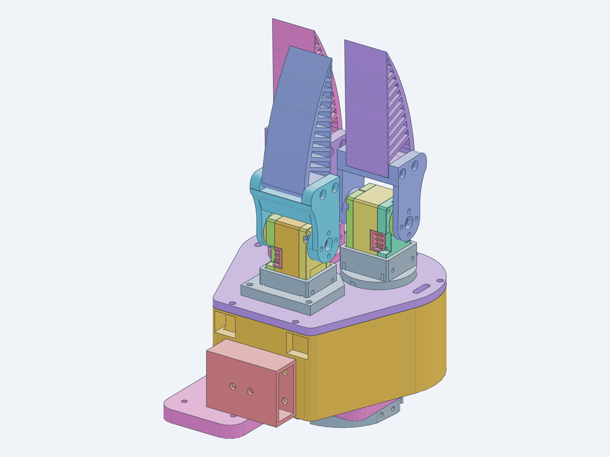
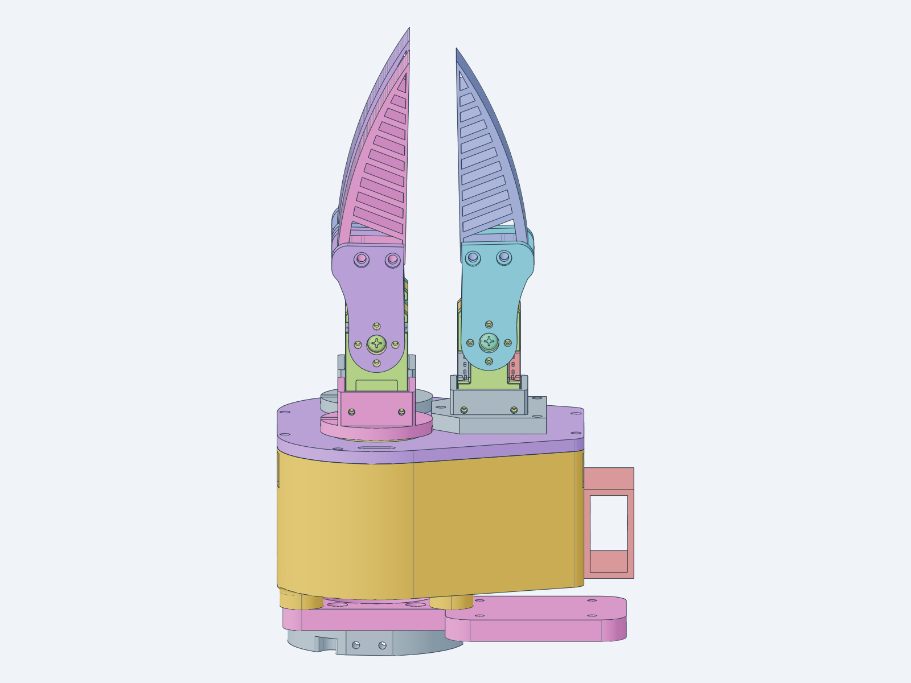

# PathOn Dexterous Hand V3 — 3 fingers, 4 motors

> **This is the hand on our robot.** V3 is PathOn Robotics' current in-house dexterous hand: built,
> calibrated, and running grasps since 2026-10-15. [V1](../v1/) stays the simplest complete kit; V3 is
> the one we use.
>
> **Released here:** the printable STLs for every part and CAD renders.
> **Assembly guide:** interactive, step by step, at **<https://web-6gov.vercel.app/>**.
> **Demo video:** [the hand picking up a plush bear on our mobile manipulator](https://www.loom.com/share/fe40257b80d7402cbd5068077b4870d3)
> (Loom, recorded 2026-10-19).

A compact 3-finger hand on **four DYNAMIXEL XL330-M288-T** servos: one servo per finger for flexion,
plus one spread servo that rotates two of the fingers about the palm through a pair of meshing gears.
Fingers are single printed links with soft fins, so the grasp conforms to the object through the fin
rather than through a second joint. The palm is a printed box with a top plate; the two spread fingers
sit on turrets that ride on F6803ZZ bearings around an idler pin.

| Isometric | Front |
|---|---|
|  |  |

*Renders of the assembled CAD. For the built hand in motion, see the
[bear pick-up video](https://www.loom.com/share/fe40257b80d7402cbd5068077b4870d3). Photos are still to be added.*

## Specs

| Spec | Value |
|---|---|
| **Fingers** | 3 (two on spread turrets + one fixed thumb) |
| **Motors / DOF** | 4 × DYNAMIXEL XL330-M288-T → 4 actuated DOF: three finger flex + one spread (the second spread finger is geared to it at −1:1) |
| **Spread** | one servo, two fingers counter-rotate through meshing printed gears |
| **Bus** | DYNAMIXEL Protocol 2.0, TTL half-duplex, all four servos daisy-chained |
| **Adapter** | Waveshare Bus Servo Adapter (A), 5 V / 4 A into the barrel jack |
| **Fingertips** | soft printed fins (`soft_fin_half_mod`) on each finger link |
| **Arm mount** | printed wrist plate with a Waveshare-adapter pocket, plus a J7 wrist adapter and a camera decoupler / bracket for a wrist camera |
| **Manufacturing** | FDM, all parts fit a 256 × 256 mm bed; bearings, pins, screws, nuts and heat-set inserts are standard purchasable parts |

As-built mass has not been measured yet.

## Assembly guide

**<https://web-6gov.vercel.app/>** — open it on a phone or tablet at the bench.

- **Plan:** tick the parts you have; the planner lists which steps you can do now and which are blocked,
  and keeps your progress in the browser.
- **Build:** 23 steps in four stages (Prepare, Palm core, Finger modules, Wrist and close-up). Each step
  shows its parts, the exact fasteners with counts, numbered actions, a key point and the reason for the
  order, next to a 3D view of the hand built up to that step. Steps animate: the part aligns, the screws
  go in from their side, the nuts come on from the other. The first step runs a motion demo of the
  finished hand.
- **Parts & screws:** every fastener drawn at 1:1 (print at 100 % and sort the hardware onto it), the
  fastener table with the reason for each size, the parts list and tools.

The guide is a web app we host; its source is not in this repository.

## Files

```
dexterous_hand/v3/
|-- stl/      # the 13 printed parts
`-- media/    # renders
```

### Parts and counts

| Part | STL | Qty |
|---|---|---|
| Palm box | `base_box.stl` | 1 |
| Top plate | `plate.stl` | 1 |
| Spread turret | `f1_turret.stl` | 2 |
| Spread gear | `f2_gear.stl` | 2 |
| Bearing seat, F6803ZZ | `f2_bearing_F6803ZZ.stl` | 2 |
| Idler pin ⌀8 × 40 | `idler_pin_8x40.stl` | 1 |
| Thumb mount | `thumb_mount.stl` | 1 |
| Finger link | `thumb_finger_link.stl` | 3 |
| Soft fin | `soft_fin_half_mod.stl` | 3 |
| Wrist plate with Waveshare mount | `mount_plate_with_waveshare_mount.stl` | 1 |
| J7 wrist adapter | `arm_J7_A.stl` | 1 |
| Camera mount decoupler | `camera_mount_decoupler.stl` | 1 |
| Camera bracket | `cam_bracket.stl` | 1 |

**Bought parts:** 4 × DYNAMIXEL XL330-M288-T with horn, Waveshare Bus Servo Adapter (A), 2 × F6803ZZ
bearings, 2 × ⌀4 × 16 cross pins, M2 / M2.5 / M3 socket-head screws, M2.5 and M3 nuts, 4 × M3
heat-set inserts. The exact fastener schedule, with counts and lengths per step, is in the assembly guide.

### Printing

There is no pre-arranged 3MF plate yet; load the STLs from `stl/` with the counts above.

| Setting | Value |
|---|---|
| Material | PLA or PETG (PETG for the finger links and turrets) |
| Layer height | 0.2 mm |
| Walls | 4 |
| Infill | 25–40% |
| Supports | Tree, only where needed |

The soft fins are printed in a flexible filament (TPU); print them separately from the rigid parts.

## Roadmap

- [x] Printable STLs
- [x] Assembly guide (hosted)
- [x] Demo video: [bear pick-up on the mobile manipulator](https://www.loom.com/share/fe40257b80d7402cbd5068077b4870d3)
- [ ] Photos of the built hand
- [ ] Pre-arranged Bambu Studio 3MF plate with print orientations
- [ ] As-built mass
- [ ] STEP, URDF and bring-up scripts

Questions or interest in V3: [Discord](https://discord.gg/xukJ3nh9wC).

## License

Hardware files in this project — CAD, meshes, assembly docs, and photos — are
covered by the [hardware LICENSE](../../../LICENSE), a Standard Digital File License:

- **Personal use** — print, build, and modify these for your own personal,
  non-commercial use.
- **No redistribution** — do not repost the files or printed parts anywhere,
  free or paid, including remixes.
- **No organizational or commercial use** without written permission — this
  applies to companies, schools, and universities alike, and covers selling the
  files or prints *and* using the parts in a product, production line, service,
  course, or lab.

Licensing for organizations, including schools and universities, is available —
contact the copyright holder.
